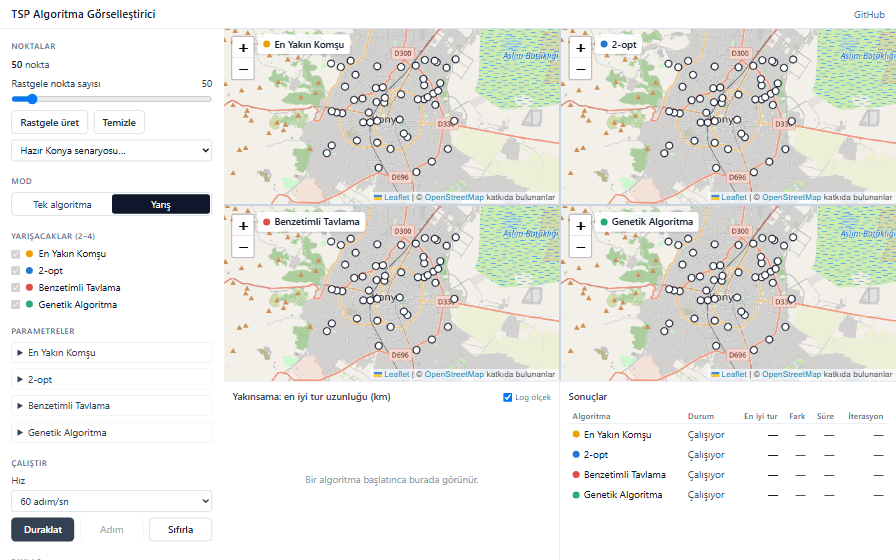
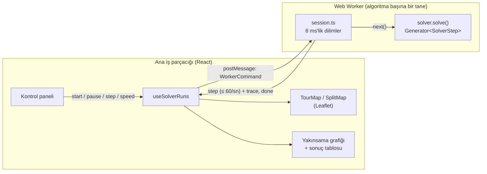

# TSP Algoritma Görselleştirici

Konya haritası üzerinde Gezgin Satıcı Problemi (TSP) için dört sezgisel algoritmayı adım adım canlı çalıştıran ve yan yana yarıştıran web uygulaması.

**▶ Canlı demo: https://elanurdemircigl.github.io/tsp-visualizer/**



## Özellikler

- **Nokta kümesi:** haritaya tıklayarak ekle/sil, 10–500 rastgele nokta üret ya da hazır Konya senaryolarından birini seç (tarihi merkez, üniversite kampüsleri, 17 duraklı Konya turu).
- **4 algoritma:** En Yakın Komşu, 2-opt, Benzetimli Tavlama, Genetik Algoritma.
- **Adım adım izleme:** oynat / duraklat / tek adım / hız ayarı (1 adım/sn'den sınırsıza). Her adımda değişen kenarlar haritada vurgulanır.
- **Parametre paneli:** algoritmaya göre değişen form (sıcaklık, soğuma oranı, popülasyon, mutasyon, seed…).
- **Yarış modu:** 2–4 algoritma aynı nokta kümesinde, her biri kendi Web Worker'ında ve kendi haritasında; haritalar birlikte kaydırılır/yakınlaştırılır.
- **Karşılaştırma:** tüm algoritmalar tek yakınsama grafiğinde (iterasyon × en iyi tur, log ölçek) ve bir sonuç tablosunda (tur uzunluğu, en iyiye göre fark, süre, iterasyon).
- **Paylaşım linki:** noktalar ve ayarlar sıkıştırılıp linkin içine yazılır; backend gerekmez.

## Algoritmalar

TSP NP-zor bir problemdir: n şehir için (n−1)!/2 farklı tur vardır, 20 şehirde bile bu 6·10¹⁶ eder. Bu yüzden kesin çözüm yerine iyi bir turu hızlıca bulan sezgisel yöntemler kullanılır.

| Algoritma | Nasıl çalışır | Karmaşıklık |
|---|---|---|
| **En Yakın Komşu** | Bir noktadan başlar, her adımda ziyaret edilmemiş en yakın noktaya gider. Çok hızlıdır ama sonlara doğru uzun "dönüş" kenarları bırakır. | O(n²) |
| **2-opt** | En Yakın Komşu turundan başlar. Kesişen iki kenarı (a,b),(c,d) → (a,c),(b,d) ile değiştirip aradaki yolu ters çevirir; iyileştiren hamle kalmayınca durur (yerel optimum). Her hamlenin kazancı O(1)'de hesaplanır. | geçiş başına O(n²) |
| **Benzetimli Tavlama (SA)** | Rastgele turdan başlar, rastgele 2-opt hamleleri dener. Kötüleştiren hamleyi exp(−Δ/T) olasılıkla kabul eder; T soğudukça açgözlüleşir. Böylece 2-opt'un takıldığı yerel optimumlardan kaçabilir. | O(K · n), K = toplam hamle (varsayılan ≈ 300 bin) |
| **Genetik Algoritma (GA)** | Rastgele turlardan oluşan popülasyon; turnuva seçimi, sıralı çaprazlama (OX), ters çevirme mutasyonu ve elitizm. | O(G · P · n), G nesil, P popülasyon |

**Neden GA kaybediyor?** Burada bilerek *saf* GA kullanıldı: popülasyon rastgele turlarla başlıyor ve çocuklar yerel aramayla iyileştirilmiyor. OX çaprazlama, ebeveynlerdeki iyi kenarları korumakta zayıf kalıyor; bu yüzden nokta sayısı arttıkça GA geride kalıyor (aşağıdaki tabloda kroA100'de %27). Pratikte GA, 2-opt gibi bir yerel aramayla birleştirilir (memetik algoritma). Bu karşılaştırma, "yerel arama + akıllı kabul kuralı" fikrinin (SA) basit bir evrimsel yaklaşımdan neden daha etkili olduğunu gösteriyor.

## Benchmark (TSPLIB)

Bilinen optimumu olan [TSPLIB](http://comopt.ifi.uni-heidelberg.de/software/TSPLIB95/) örneklerinde, varsayılan parametrelerle (`pnpm bench`):

| Örnek | n | Algoritma | Optimuma sapma | En iyi seed | Süre |
|---|---:|---|---:|---:|---:|
| berlin52 | 52 | En Yakın Komşu | %19,1 | — | 2 ms |
| berlin52 | 52 | 2-opt | %6,9 | — | 2 ms |
| berlin52 | 52 | Benzetimli Tavlama | %0,0¹ | %0,0 | 85 ms |
| berlin52 | 52 | Genetik Algoritma | %7,4¹ | %3,8 | 158 ms |
| eil76 | 76 | En Yakın Komşu | %19,3 | — | 2 ms |
| eil76 | 76 | 2-opt | %6,1 | — | 1 ms |
| eil76 | 76 | Benzetimli Tavlama | %3,4¹ | %3,0 | 125 ms |
| eil76 | 76 | Genetik Algoritma | %12,0¹ | %10,0 | 288 ms |
| kroA100 | 100 | En Yakın Komşu | %30,7 | — | 0 ms |
| kroA100 | 100 | 2-opt | %9,2 | — | 1 ms |
| kroA100 | 100 | Benzetimli Tavlama | %2,8¹ | %1,7 | 75 ms |
| kroA100 | 100 | Genetik Algoritma | %27,2¹ | %22,8 | 284 ms |

¹ 5 farklı seed'in ortalaması. Süreler tek iş parçacığında Node 24 ile ölçüldü. Mesafeler TSPLIB'in EUC_2D kuralıyla (Öklid mesafesi, en yakın tamsayıya yuvarlanmış) hesaplanır; böylece sonuçlar yayımlanmış optimumlarla (7542, 538, 21282) doğrudan karşılaştırılabilir.

## Mimari

Algoritmalar arayüzü dondurmasın diye her biri ayrı bir **Web Worker**'da çalışır. Her çözücü bir **generator**'dır: `yield` ile bir adım (`SolverStep`) üretir ve durur; Worker onu dilimler hâlinde ilerletir.



- **Neden UI donmuyor?** Worker çözücüyü 8 ms'lik dilimlerle ilerletir; dilimler arasında gelen `pause`/`stop` komutları hemen işlenir. Ana iş parçacığı yalnızca çizim yapar.
- **Saniyede 60 sınırı çözücüyü yavaşlatmaz.** Sınırsız hızda çözücü kendi hızında çalışır, UI'a en fazla saniyede 60 kez yalnızca en güncel adım gider. Atlanan adımlardaki iyileşmeler `trace` olarak ayrıca gönderilir; böylece 2 ms'de biten 2-opt'un yakınsama eğrisi de eksiksiz çizilir.
- **Tek sözleşme:** modüller arasındaki tek bağ [`packages/core/src/types.ts`](packages/core/src/types.ts) dosyasıdır (`Solver`, `SolverStep`, `WorkerCommand`, `WorkerEvent`). Harita ve UI, algoritmaların içini bilmez.
- **Tekrarlanabilirlik:** SA ve GA tohumlu bir PRNG (mulberry32) kullanır; aynı seed aynı sonucu verir, yarış adil olur.

## Teknolojiler

React 18 · TypeScript · Vite · Tailwind CSS · Leaflet + OpenStreetMap · Recharts · Web Worker · Vitest · Playwright · GitHub Actions + Pages · pnpm workspaces

## Kurulum

```sh
pnpm install
pnpm dev         # http://localhost:5173
pnpm test        # birim testleri (core, solvers, web)
pnpm e2e         # Playwright uçtan uca testleri
pnpm bench       # TSPLIB benchmark → benchmarks/results.md
```

```
packages/
  core/      # tipler (types.ts) + haversine mesafe matrisi
  solvers/   # NN, 2-opt, SA, GA (generator) + testler
  web/       # React uygulaması
    src/map/     # harita, tur çizimi, yarış haritaları
    src/ui/      # kontrol paneli, grafik, tablo, paylaşım
    src/worker/  # Web Worker protokolü
benchmarks/  # TSPLIB örnekleri ve benchmark betiği
e2e/         # Playwright testleri
```

## Ajanlarla nasıl geliştirildi

Proje, yapay zekâ kodlama ajanlarının (ya da bir ekibin) paralel çalışabileceği şekilde bölündü. Her rolün yalnızca kendi klasörüne yazdığı, modüllerin yalnızca `types.ts` üzerinden konuştuğu kurallar [AGENTS.md](AGENTS.md) dosyasında:

| Rol | Klasör | Teslim ettiği |
|---|---|---|
| Koordinatör | `packages/core`, kök dosyalar | sözleşme (types.ts), mesafe hesabı, birleştirme |
| Algoritma | `packages/solvers`, `web/src/worker` | 4 çözücü, Worker protokolü, birim testleri |
| Harita | `web/src/map` | nokta ekleme, tur çizimi, bölünmüş harita |
| UI | `web/src/ui` | panel, parametre formu, grafik, tablo |
| QA / DevOps | `e2e/`, `benchmarks/`, `.github/` | E2E testleri, benchmark, CI/CD |

Harita ve UI, çözücüler hazır olmadan sözleşmedeki tiplere göre geliştirilebildi. Sözleşme değişiklikleri [docs/requests.md](docs/requests.md) dosyasında duyuruldu.

## Ders projesinden gelişimi

<!-- TODO(Elanur): Grup 13 çalışmasında ne yapıldığını ve bu projede neyin geliştirildiğini bir paragrafta anlat. -->

## Yol haritası

- [x] 4 algoritma, harita, kontrol paneli, yarış modu, yakınsama grafiği
- [x] Hazır Konya senaryoları, paylaşım linki, TSPLIB benchmark
- [ ] Gerçek yol mesafeleri (OSRM mesafe matrisi)
- [ ] Karınca Kolonisi (ACO) ve Or-opt
- [ ] Spring Boot + PostgreSQL backend: kısa paylaşım linki ve senaryo kaydı
- [ ] Öğretici mod: her adımın açıklaması

## Lisans

[MIT](LICENSE). Harita verisi © [OpenStreetMap](https://www.openstreetmap.org/copyright) katkıda bulunanlar.
